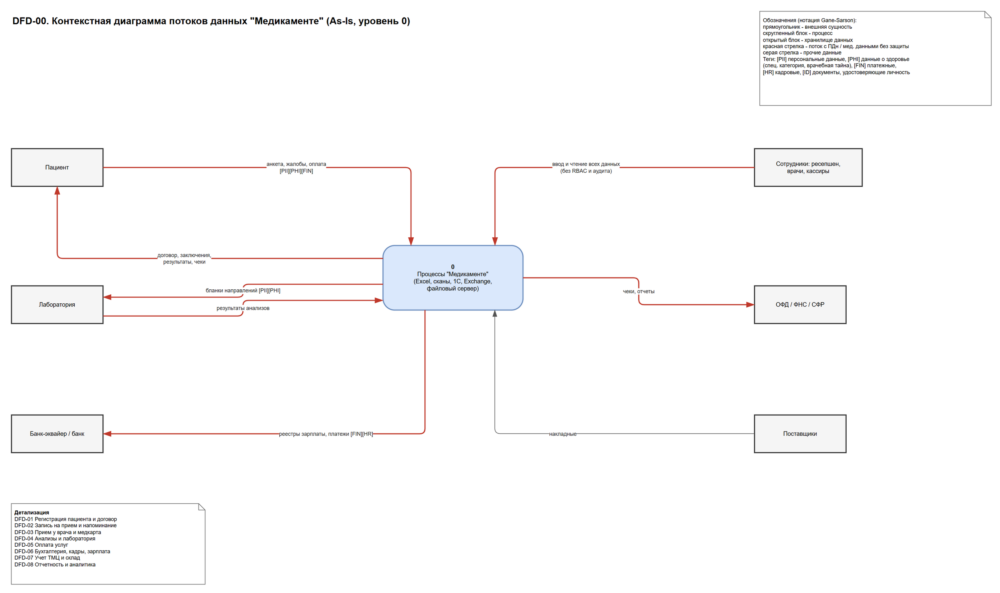
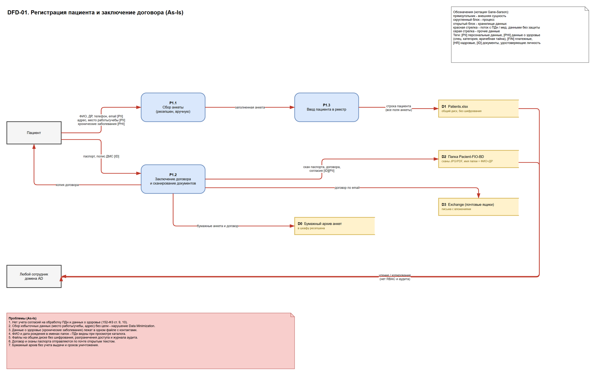
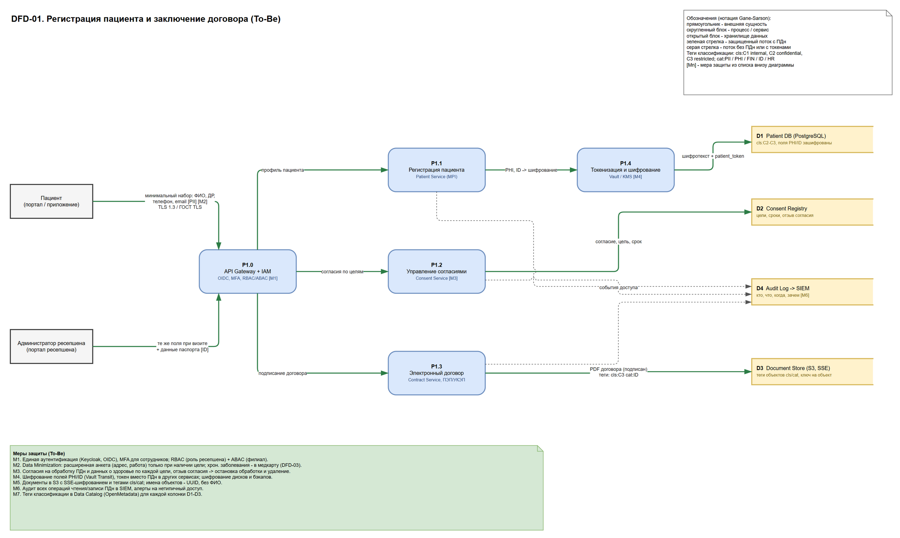

# Задание 1. Анализ безопасности системы

## Состав

| Файл | Содержание |
| --- | --- |
| [01-problems.md](01-problems.md) | Неучтенные конфиденциальные данные и список проблемных зон (аудит As-Is) |
| [02-data-protection.md](02-data-protection.md) | Список данных для защиты и способы защиты (шифрование, обфускация, обезличивание) |
| [03-tagging.md](03-tagging.md) | Механизм тегирования данных |
| [04-tools-and-measures.md](04-tools-and-measures.md) | Инструменты, способы и меры обеспечения конфиденциальности |
| [diagrams/](diagrams/) | Диаграммы потоков данных (draw.io + PNG) |

## Диаграммы потоков данных (DFD)

Нотация Gane-Sarson. В каждом файле `.drawio` две страницы: **As-Is** (текущее состояние,
красным выделены незащищенные потоки с ПДн и проблемы) и **To-Be** (доработанная диаграмма:
что использовать на каждом этапе потока, зеленым - защищенные потоки, метки [Мn] - меры).

| N | Процесс | Исходник | As-Is | To-Be |
| --- | --- | --- | --- | --- |
| 00 | Контекстная диаграмма (уровень 0) | [drawio](diagrams/DFD-00-context.drawio) | [png](diagrams/DFD-00-context-as-is.png) | - |
| 01 | Регистрация пациента и договор | [drawio](diagrams/DFD-01-registration.drawio) | [png](diagrams/DFD-01-registration-as-is.png) | [png](diagrams/DFD-01-registration-to-be.png) |
| 02 | Запись на прием и напоминание | [drawio](diagrams/DFD-02-appointment.drawio) | [png](diagrams/DFD-02-appointment-as-is.png) | [png](diagrams/DFD-02-appointment-to-be.png) |
| 03 | Прием у врача и медкарта | [drawio](diagrams/DFD-03-medical-record.drawio) | [png](diagrams/DFD-03-medical-record-as-is.png) | [png](diagrams/DFD-03-medical-record-to-be.png) |
| 04 | Анализы и лаборатория | [drawio](diagrams/DFD-04-laboratory.drawio) | [png](diagrams/DFD-04-laboratory-as-is.png) | [png](diagrams/DFD-04-laboratory-to-be.png) |
| 05 | Оплата услуг | [drawio](diagrams/DFD-05-payment.drawio) | [png](diagrams/DFD-05-payment-as-is.png) | [png](diagrams/DFD-05-payment-to-be.png) |
| 06 | Бухгалтерия, кадры, зарплата | [drawio](diagrams/DFD-06-accounting-hr.drawio) | [png](diagrams/DFD-06-accounting-hr-as-is.png) | [png](diagrams/DFD-06-accounting-hr-to-be.png) |
| 07 | Учет ТМЦ и склад | [drawio](diagrams/DFD-07-warehouse.drawio) | [png](diagrams/DFD-07-warehouse-as-is.png) | [png](diagrams/DFD-07-warehouse-to-be.png) |
| 08 | Отчетность и аналитика | [drawio](diagrams/DFD-08-analytics.drawio) | [png](diagrams/DFD-08-analytics-as-is.png) | [png](diagrams/DFD-08-analytics-to-be.png) |

### Контекст (As-Is)

### Пример: регистрация пациента

## Ключевые выводы

1. Наиболее критичные проблемы: данные о здоровье (специальная категория ПДн и врачебная тайна)
   хранятся в Excel и сканах на общем диске без шифрования, разграничения доступа и аудита;
   нет согласий и договора-поручения с лабораторией; ПДн передаются по открытой почте.
2. Не учтены во внутренних системах: хронические заболевания и причины обращения, ПДн в именах
   папок, перечень услуг в чеках и 1С, ФИО в складских списаниях, локальные копии у аналитика.
3. Целевой подход: классификация и тегирование данных (C0-C3), разделение доменов, токенизация
   на границах доменов, шифрование полей C3, ABAC, централизованный аудит и lineage.
