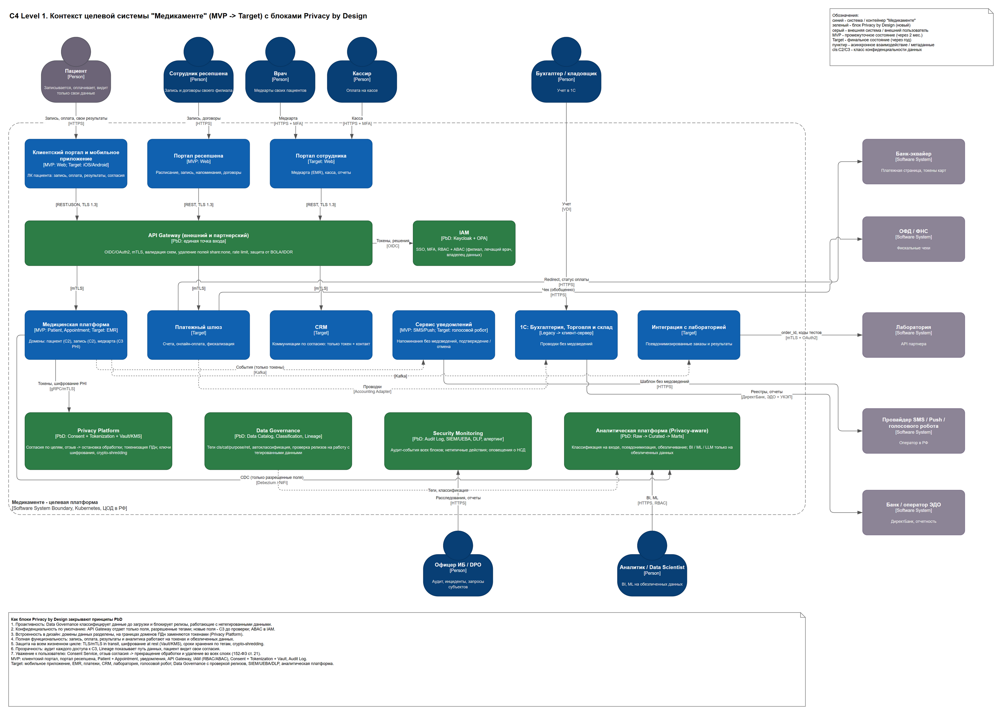
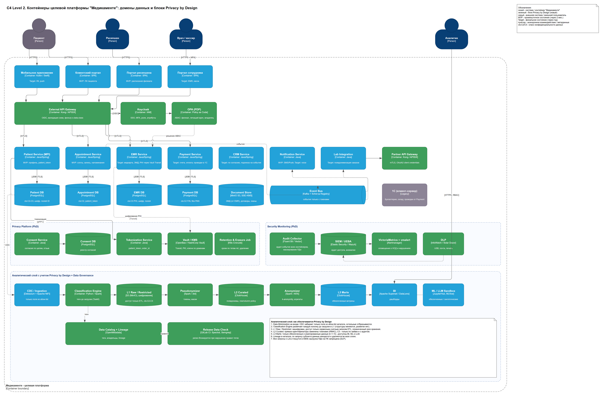

# Задание 2. Проектирование решения (Privacy by Design)

## Состав

| Файл | Содержание |
| --- | --- |
| [C4-to-be.drawio](C4-to-be.drawio) | Исходник: страница 1 - C4 Context (To-Be), страница 2 - C4 Container (To-Be) |
| [C4-context-to-be.png](C4-context-to-be.png) | Диаграмма контекста C4 целевого состояния (MVP -> Target) |
| [C4-container-to-be.png](C4-container-to-be.png) | Детализация до контейнеров: домены данных, блоки PbD, аналитический слой |

## 1. Диаграмма контекста C4 (To-Be)

## 2. Новые блоки, обеспечивающие Privacy by Design

| Блок | Состав | Что обеспечивает | Принципы PbD |
| --- | --- | --- | --- |
| **API Gateway** (внешний и партнерский) | Kong / APISIX, плагины OPA | Единая точка входа для портала, приложения, CRM и партнеров; OIDC/OAuth2, mTLS, валидация схем, фильтрация полей по тегам `x-data-class` / `share`, защита от BOLA/IDOR, rate limit. Новые интеграции получают только поля, разрешенные тегами, и не требуют перевалидации | 2, 3, 5 |
| **IAM** | Keycloak + Open Policy Agent | SSO, MFA для сотрудников, OTP для пациентов, RBAC (роли) + ABAC (филиал, лечащий врач, владелец данных `patient_id = sub`), break-glass с аудитом | 2, 3 |
| **Privacy Platform** | Consent Service, Tokenization Service, Vault / KMS, Retention & Erasure Job | Согласия по целям обработки и их отзыв (остановка обработки); замена ПДн токенами на границах доменов; шифрование полей C3 ключами доменов; сроки хранения и удаление по тегам, crypto-shredding | 1, 5, 7 |
| **Data Governance** | OpenMetadata (каталог, lineage), Classification Engine, Release Data Check в CI | Классификация и тегирование данных, владельцы данных, lineage; автоматическая проверка релизов на работу с тегированными данными | 1, 3, 6 |
| **Security Monitoring** | Audit Collector (Fluent Bit / Vector), SIEM / UEBA (Elastic Security или Wazuh), VictoriaMetrics + vmalert, DLP | Аудит доступа к данным, выявление нетипичных действий, оповещения команды о несанкционированном доступе, контроль утечек | 5, 6 |
| **Аналитическая платформа (Privacy-aware)** | CDC / NiFi, Classification Engine, слои L1 Raw / L2 Curated / L3 Marts, Pseudonymizer, Anonymizer, BI, ML Sandbox | Аналитика, BI, ML и LLM на псевдонимизированных и обезличенных данных | 1, 2, 4, 5 |

Принципы PbD: 1 - проактивность; 2 - конфиденциальность по умолчанию; 3 - встроенность в дизайн;
4 - полная функциональность; 5 - защита на всем жизненном цикле; 6 - прозрачность;
7 - уважение к пользователю.

## 3. Слой аналитической работы с данными

| Слой | Хранилище | Содержимое | Доступ |
| --- | --- | --- | --- |
| Ingestion | Debezium (CDC) + Apache NiFi | Только поля из allow-list каталога (Data Minimization) | Сервисные учетные записи |
| Classification | Classification Engine (Task6) | Теги `cls/cat` для каждой колонки до загрузки | - |
| L1 Raw / Restricted | S3 (MinIO), шифрование SSE-KMS | Сырые данные C2-C3, ограниченный срок хранения | Только ETL, каждое чтение - в SIEM |
| L2 Curated | ClickHouse | Очищенные данные, прямые идентификаторы заменены токенами (HMAC), C3 маскированы | Data Engineers, аналитики по заявке; row / column policies |
| L3 Marts | ClickHouse | Обезличенные и агрегированные витрины (k-anonymity, k >= 5) | BI, ML, LLM, руководство |
| Metadata | OpenMetadata | Теги, владельцы, lineage, качество классификации | Data Steward, DPO |

Удаление данных по запросу субъекта: по `patient_token` через lineage находятся все производные
наборы; в L1 и L2 записи удаляются, в L3 данные уже обезличены; для бэкапов уничтожается ключ.

## 4. MVP: домены и категории данных пациента, RBAC / ABAC

Требование промежуточного состояния: определить категории данных пациентов, разнести их по
доменам и для каждой категории определить роли (RBAC) или атрибуты (ABAC).

| Домен (сервис) | Категория данных | Класс | Роли с доступом (RBAC) | Атрибуты (ABAC) |
| --- | --- | --- | --- | --- |
| Patient (MPI) | Идентификация: ФИО, дата рождения | C2 | `patient` (свои), `reception` (чтение / запись), `doctor` (чтение) | `patient_id = token.sub`; `branch_id` сотрудника = филиал обслуживания пациента |
| Patient (MPI) | Контакты: телефон, email | C2 | `patient`, `reception`, сервис `notification` | Ресепшен видит маску, полное значение - по действию "позвонить" с аудитом; уведомления - только при наличии согласия `purpose:appointment` |
| Patient (MPI) | Документы: паспорт, полис | C3 | `reception` (ввод), `patient` (свои) | Только при оформлении договора; чтение с аудитом |
| Consent | Согласия по целям | C2 | `patient` (свои, отзыв), `reception` (оформление), `dpo` | `patient_id = token.sub` |
| Appointment | Запись: слот, врач, код услуги | C2 | `patient` (свои), `reception`, `doctor` (свое расписание) | `doctor_id = token.sub` для врача; `branch_id` для ресепшена |
| EMR (Target) | Медицинские данные: анамнез, диагнозы, заключения, результаты анализов | C3 PHI | `doctor`, `patient` (свои, только просмотр) | Лечащая связь: у врача есть визит пациента за N дней или направление; иначе break-glass с причиной |
| Payment (Target) | Счета и платежи | C2 FIN | `patient` (свои), `cashier`, `accountant` (агрегаты) | `branch_id` для кассира |
| Notification | Шаблоны и статусы отправки | C1 | сервис `notification` | Получает телефон по токену в момент отправки, не хранит ПДн |
| Analytics | Обезличенные витрины | C1 | `analyst`, `management` | Доступ к L2 - по заявке с целью `purpose:analytics` |

Роли MVP: `patient`, `reception`, `doctor`, `dpo`, `admin` (без доступа к данным, только конфигурация).
Роли Target: дополнительно `cashier`, `accountant`, `analyst`, `data_engineer`, `security_officer`.

## 5. Как решение покрывает цели бизнеса и НФТ

| Цель / НФТ | Как обеспечивается |
| --- | --- |
| Интеграция лаборатории через API | Partner API Gateway, псевдонимизированные контракты (order_id), защита от BOLA, теги полей в OpenAPI - новые партнеры подключаются без перевалидации |
| BI, ML, AI | Аналитическая платформа со слоями и классификацией на входе |
| MVP записи и финальное состояние | Портал / приложение -> Appointment -> Notification (push / SMS / голосовой робот), подтверждение / отмена -> событие ресепшену |
| Безопасность | Шифрование, токенизация, ABAC, аудит, SIEM, DLP, удаление по запросу |
| Масштабируемость | Kubernetes, stateless-сервисы, Kafka, горизонтальное масштабирование ClickHouse; филиал - атрибут `branch_id`, а не отдельная копия данных |
| Сопровождаемость | Доменные сервисы с четкими границами, policy as code (OPA), каталог данных |
| Конфигурируемость | Политики доступа, теги, шаблоны уведомлений и сроки хранения меняются в конфигурации без доработки кода |
