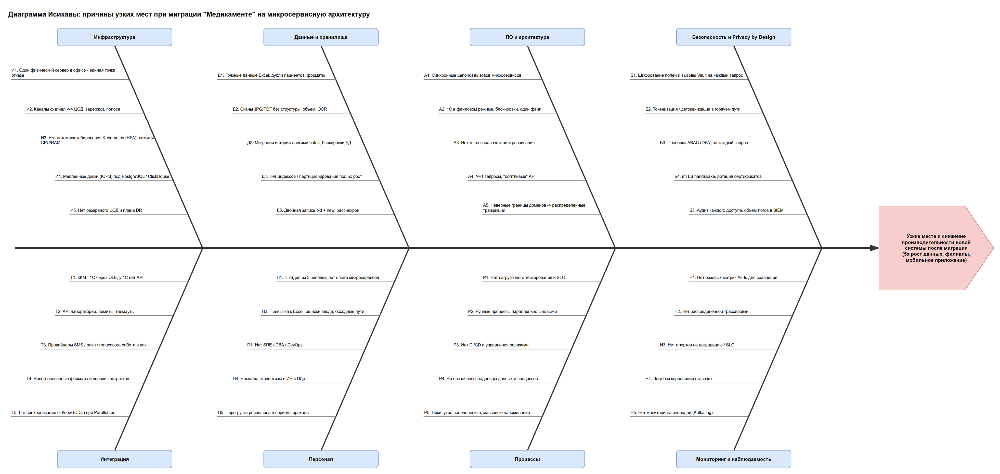

# Задание 4. Оценка узких мест при миграции

## Состав

| Файл | Содержание |
| --- | --- |
| [ishikawa.drawio](ishikawa.drawio) | Диаграмма Исикавы (draw.io) |
| [ishikawa.png](ishikawa.png) | Экспорт диаграммы |
| README.md | Отчет: анализ ситуации, проблемы, рекомендации и приоритеты |

## 1. Анализ ситуации

### 1.1. Текущая система и цели миграции

As-Is: ручная работа в Excel и сканах на общем диске, 1С:Бухгалтерия и 1С:Торговля и склад
в файловом режиме, ККМ интегрированы с 1С по OLE, все развернуто на одном физическом сервере
Windows Server 2022 в офисе (AD, DNS, DHCP, файловый сервер, Exchange).

Цели миграции: единая система хранения и управления данными (запись, пациенты, оплаты),
клиентский портал и мобильное приложение, портал ресепшена, платежный шлюз, CRM, API лаборатории,
аналитическая платформа; поддержка 5-кратного роста объема данных, новых филиалов и десятков
новых сотрудников; соответствие 152-ФЗ.

Целевая архитектура: доменные микросервисы на Java в Kubernetes, PostgreSQL на сервис,
Kafka, ClickHouse для аналитики, блоки Privacy by Design (Task2).

### 1.2. Ключевые процессы и компоненты, затрагиваемые миграцией

| Компонент / процесс | Что меняется | Риск для производительности |
| --- | --- | --- |
| Базы данных | Excel -> PostgreSQL по доменам; 1С файловый -> клиент-серверный | Перенос и очистка истории, индексы, блокировки, рост объема в 5 раз |
| Коммуникационные каналы | Локальная сеть -> филиалы, интернет-клиенты, мобильное приложение | Задержки WAN, пики трафика, зависимость от провайдеров |
| Серверное оборудование | Один сервер -> кластер Kubernetes (ЦОД / облако в РФ) | Сайзинг, IOPS, отказоустойчивость |
| Бизнес-логика | Ручные процессы -> сервисы записи, оплаты, медкарты, уведомлений | Синхронные цепочки вызовов, распределенные транзакции |
| Интеграции | OLE ККМ - 1С, email с лабораторией -> API, Kafka | Лимиты внешних API, лаг синхронизации |
| Безопасность | Только доменная аутентификация -> IAM, ABAC, шифрование, токенизация, аудит | Дополнительные задержки на каждый запрос |
| Люди и процессы | 3 человека в IT, сотрудники привыкли к Excel | Нехватка экспертизы, ошибки, сопротивление изменениям |

## 2. Категории и выявленные проблемы

Подробно - на диаграмме. Для каждой категории указано влияние на производительность.

| Категория | Проблемы | Как проявится |
| --- | --- | --- |
| Инфраструктура | И1 единая точка отказа; И2 каналы филиалов; И3 нет HPA; И4 медленные диски; И5 нет DR | Недоступность всей системы при отказе сервера, рост времени ответа в филиалах, деградация БД при росте нагрузки |
| Данные и хранилища | Д1 дубли и грязные данные; Д2 неструктурированные сканы; Д3 тяжелая миграция истории; Д4 нет индексов и партиционирования; Д5 двойная запись | Медленный поиск пациента, блокировки при загрузке, рассинхрон двух систем |
| ПО и архитектура | А1 синхронные цепочки; А2 1С файловый режим; А3 нет кэша; А4 N+1 и болтливые API; А5 неверные границы доменов | Каскадный рост latency (p95/p99), таймауты, блокировки 1С при росте числа пользователей |
| Безопасность и PbD | Б1 шифрование и Vault в горячем пути; Б2 токенизация; Б3 ABAC на каждый запрос; Б4 mTLS; Б5 объем аудита | +5-30 мс на запрос на каждом шаге, узкое место Vault / OPA, переполнение SIEM |
| Интеграция | Т1 OLE ККМ - 1С; Т2 лимиты API лаборатории; Т3 провайдеры уведомлений в пик; Т4 версии контрактов; Т5 лаг CDC | Очереди и задержки оплаты, неполученные напоминания, ошибки обмена |
| Персонал | П1 маленькая команда; П2 привычка к Excel; П3 нет SRE/DBA/DevOps; П4 нет экспертизы ИБ; П5 перегрузка ресепшена | Медленное устранение инцидентов, ошибки конфигурации, обходные ручные пути |
| Процессы | Р1 нет нагрузочного тестирования и SLO; Р2 ручные процессы параллельно; Р3 нет CI/CD; Р4 нет владельцев; Р5 пиковые нагрузки | Проблемы выявляются уже в продуктиве, рост нагрузки в часы пик |
| Мониторинг | Н1 нет baseline; Н2 нет трассировки; Н3 нет алертов; Н4 логи без корреляции; Н5 нет мониторинга очередей | Невозможно найти узкое место и доказать улучшение, долгий MTTR |

## 3. Рекомендации и приоритеты

Приоритет: **P1** - до запуска MVP (блокер), **P2** - до перевода всех филиалов,
**P3** - в течение года (Target). Оценка: влияние (В / С / Н) и трудоемкость.

| N | Мера | Устраняет | Влияние | Трудоемкость | Приоритет |
| --- | --- | --- | --- | --- | --- |
| R1 | Развернуть отказоустойчивый кластер Kubernetes (минимум 3 узла) в ЦОД в РФ, резервное копирование и план DR (RPO =< 15 мин, RTO =< 4 ч) | И1, И5 | В | С | P1 |
| R2 | Определить SLO (например, p95 записи на прием =< 500 мс, доступность 99,9 %), снять baseline As-Is | Р1, Н1 | В | Н | P1 |
| R3 | Наблюдаемость: VictoriaMetrics + Grafana, OpenTelemetry трассировка, trace id в логах, алерты на SLO и Kafka lag | Н2-Н5 | В | С | P1 |
| R4 | Нагрузочное тестирование (k6 / Gatling) профилем 5x текущей нагрузки + пики (утро понедельника, массовые напоминания) перед каждым этапом | Р1, Р5, И3 | В | С | P1 |
| R5 | Очистка и дедупликация данных перед миграцией (MPI, правила сопоставления пациентов), загрузка истории инкрементально вне рабочих часов | Д1, Д3 | В | С | P1 |
| R6 | Асинхронное взаимодействие через Kafka вместо синхронных цепочек; паттерны Saga / Outbox вместо распределенных транзакций; таймауты, retry, circuit breaker | А1, А5, Т2 | В | С | P1 |
| R7 | Кэширование справочников, расписания и решений OPA (Redis / локальный кэш с TTL), BFF для мобильного приложения вместо болтливых API | А3, А4, Б3 | С | Н | P2 |
| R8 | Оптимизация PbD-механизмов: envelope encryption с кэшем DEK, детокенизация только на границе (UI / уведомления), локальный sidecar OPA, асинхронная отправка аудита через буфер | Б1-Б5 | С | С | P2 |
| R9 | Индексы, партиционирование (по дате / филиалу), connection pooling (PgBouncer), реплики на чтение; сайзинг дисков (SSD / NVMe) | Д4, И4 | В | С | P2 |
| R10 | HPA / автомасштабирование сервисов, лимиты ресурсов, отдельные пулы узлов для БД и аналитики | И3 | С | Н | P2 |
| R11 | Перевод 1С в клиент-серверный режим (PostgreSQL), интеграция через HTTP-сервисы / адаптер вместо OLE | А2, Т1 | В | С | P2 |
| R12 | Парный провайдер уведомлений (резервный), очереди с rate limit, приоритезация напоминаний | Т3 | С | Н | P2 |
| R13 | Контракты API с версионированием (OpenAPI + Schema Registry), контрактные тесты | Т4 | С | Н | P2 |
| R14 | Мониторинг лага CDC и автоматическая сверка данных old/new на этапе параллельной работы | Д5, Т5 | В | Н | P1 |
| R15 | Каналы филиалов: два провайдера, VPN-криптошлюзы, CDN для статики портала | И2 | С | С | P2 |
| R16 | Усиление команды: SRE/DevOps, DBA, специалист по ИБ (руководство готово выделить ресурсы); обучение текущих сотрудников | П1, П3, П4 | В | С | P1 |
| R17 | CI/CD с автоматическими проверками (тесты, теги данных, безопасность), feature flags для поэтапного включения | Р3 | В | С | P1 |
| R18 | Обучение ресепшена и врачей, "суперпользователи" в каждом филиале, временное усиление ресепшена в период перехода | П2, П5, Р2 | С | Н | P2 |
| R19 | Назначить владельцев доменов данных и процессов (RACI) | Р4 | С | Н | P1 |
| R20 | Хранение сканов в объектном хранилище, OCR и извлечение структуры в фоне | Д2 | Н | С | P3 |

### Порядок внедрения

1. **P1 (до MVP):** R1, R2, R3, R4, R5, R6, R14, R16, R17, R19 - без них невозможно запустить
   MVP записи с контролируемой производительностью и диагностировать проблемы.
2. **P2 (до перевода всех филиалов):** R7-R13, R15, R18 - снимают узкие места при 5-кратном росте.
3. **P3 (Target):** R20 и дальнейшая оптимизация по результатам мониторинга.

## 4. Системные выводы

1. Главный риск производительности - не отдельный компонент, а сочетание синхронных вызовов
   между сервисами (А1) с накладными расходами безопасности на каждом шаге (Б1-Б3). Решение -
   асинхронность, кэширование решений и ключей, детокенизация только на границе.
2. Без baseline и SLO (Н1, Р1) деградацию невозможно ни измерить, ни доказать улучшение, поэтому
   наблюдаемость и нагрузочные тесты - первые меры, а не последние.
3. Закон Конвея: команда из 3 человек не сможет поддерживать много мелких сервисов. Границы
   сервисов надо выбирать крупнее (домены: пациент, запись, медкарта, оплата, интеграции),
   а команду - усилить (R16).
4. Данные - отдельный риск: грязные Excel-данные и двойной учет переносятся в новую систему,
   если не провести очистку и сверку (R5, R14).
