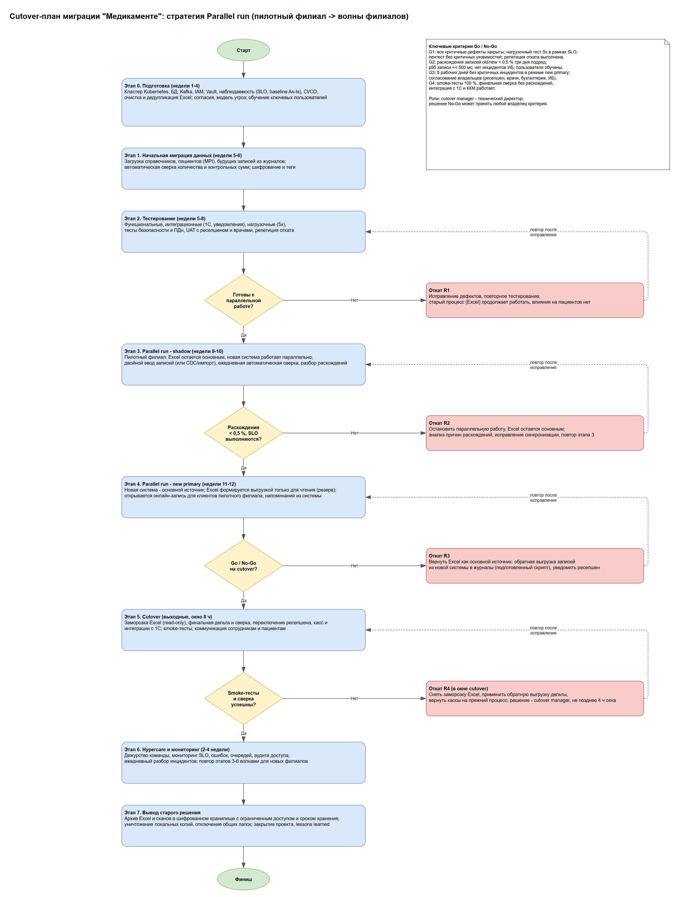

# Задание 5. Разработка cutover-плана

## Состав

| Файл | Содержание |
| --- | --- |
| README.md | Обоснование стратегии, cutover-план (таблица), риски, роли, план действий при проблемах |
| [cutover-plan.drawio](cutover-plan.drawio) | Блок-схема cutover-плана с точками Go / No-Go и откатами |
| [cutover-plan.png](cutover-plan.png) | Экспорт блок-схемы |

## 1. Анализ ситуации

| Аспект | As-Is | To-Be |
| --- | --- | --- |
| Запись, пациенты, медкарты, анализы | Excel и сканы на общем диске, ручной ввод | Patient, Appointment, EMR, Lab Integration (Task2) |
| Оплата | ККМ -> 1С (OLE) + двойной учет в Excel | Payment Service, адаптер к 1С |
| Бухгалтерия и склад | 1С в файловом режиме | 1С в клиент-серверном режиме (остается) |
| Инфраструктура | Один сервер в офисе | Кластер Kubernetes в ЦОД в РФ |
| Пользователи | 1 офис, 35 сотрудников | Несколько филиалов, десятки новых сотрудников, пациенты онлайн |

Бизнес-цели миграции: MVP онлайн-записи через 2 месяца, полная автоматизация через год,
5-кратный рост данных, соответствие 152-ФЗ. Ключевое ограничение - медицинский процесс нельзя
останавливать: пациент, пришедший на прием, должен быть принят, даже если новая система
недоступна.

## 2. Выбор стратегии: Parallel run

| Вариант | Плюсы для "Медикаменте" | Минусы / ограничения | Вывод |
| --- | --- | --- | --- |
| High-level design | Хорош для проектирования доменов и границ (уже сделано в Task2) | Это скорее подход к проектированию, а не к переключению; не дает механизма безопасного перехода | Используется как основа архитектуры, но не как стратегия cutover |
| **Parallel run** | Старый процесс (Excel) уже работает и не требует доработки; можно сравнивать результаты old/new и откатиться в любой момент; переход по филиалам; пациенты не страдают при сбоях | Двойная нагрузка на ресепшен, нужна синхронизация и сверка данных, временное существование двух копий ПДн | **Выбран** |
| Branch by abstraction | Подходит для постепенной замены модулей внутри одного кодового монолита | Excel и ручные процессы - не код: в них нельзя встроить слой абстракции; 1С остается отдельной системой | Не подходит для основной части; применяется точечно для интеграции оплаты с 1С (адаптер Accounting Adapter) |

**Обоснование выбора Parallel run:**

1. Заменяется в основном ручной процесс, а не программный модуль, - сравнить "как было" и "как
   стало" можно только запустив оба процесса одновременно.
2. Минимальный риск для пациентов: при любой проблеме ресепшен продолжает работать по Excel.
3. Есть естественная единица постепенного перехода - филиал (сначала пилотный офис, затем
   новые филиалы волнами), а внутри филиала - функция (запись -> напоминания -> оплата -> медкарта).
4. Сверка old/new дает измеримые критерии Go / No-Go.

**Ограничения и как их компенсировать:** двойной ввод сокращается импортом / CDC из новой системы
в Excel-выгрузку; период параллельной работы ограничен 2-4 неделями на волну; временная копия ПДн
в Excel защищается (доступ только ресепшену филиала, режим только чтения на этапе new primary,
уничтожение после вывода).

## 3. Cutover-план

Блок-схема: [cutover-plan.png](cutover-plan.png).

Сроки привязаны к целям: MVP онлайн-записи - к концу 12-й недели (около 3 месяцев с учетом
подготовки), далее волны функций и филиалов до финального состояния через год.

| Этап | Описание действия | Ключевые задачи | Ответственные | Время / Сроки | Риски и меры по снижению |
| --- | --- | --- | --- | --- | --- |
| 0. Подготовка | Подготовка платформы, данных и людей | Кластер Kubernetes, PostgreSQL, Kafka, Keycloak, Vault; наблюдаемость (SLO, baseline As-Is); CI/CD; очистка и дедупликация Excel; формы согласий; модель угроз; скрипты обратной выгрузки в Excel; обучение ключевых пользователей | Технический директор (A), DevOps/SRE, администратор сети, бизнес-аналитик, специалист ИБ | Недели 1-4 | Нехватка компетенций -> найм SRE, DBA, ИБ; грязные данные -> правила MPI-сопоставления, ручная проверка спорных случаев |
| 1. Начальная миграция данных | Перенос справочников, пациентов и будущих записей | Загрузка в Patient и Appointment; шифрование и теги; сверка количества записей и контрольных сумм; отчет о расхождениях | DBA, бизнес-аналитик (сверка), разработчики | Недели 5-6 | Потеря / искажение данных -> идемпотентные загрузки, сверка, хранение исходных файлов до вывода |
| 2. Тестирование | Проверка функций, производительности и безопасности | Функциональные и интеграционные тесты (1С, уведомления), нагрузочный тест 5x, пентест и проверка ПДн, UAT с ресепшеном и врачами, репетиция отката | QA, разработчики, специалист ИБ, руководитель ресепшена (UAT) | Недели 5-8 | Дефекты в продуктиве -> критерии G1, автоматизированные регрессионные тесты |
| G1 | Готовность к параллельной работе | Решение Go / No-Go | Технический директор + владельцы | Конец недели 8 | No-Go -> откат R1 |
| 3. Parallel run (shadow) | Пилотный филиал работает в обеих системах, Excel - основной | Ввод записей в новую систему (Excel обновляется импортом), ежедневная автоматическая сверка, разбор расхождений, мониторинг SLO | Руководитель ресепшена, бизнес-аналитик, SRE | Недели 9-10 | Рассинхронизация -> ежедневная сверка, мониторинг лага; перегрузка ресепшена -> временный дополнительный сотрудник |
| G2 | Качество данных и производительности | Расхождения < 0,5 % три дня подряд, SLO выполняются | Бизнес-аналитик, SRE | Конец недели 10 | No-Go -> откат R2 |
| 4. Parallel run (new primary) | Новая система - основной источник, Excel - резервная выгрузка | Онлайн-запись для клиентов пилотного филиала, напоминания из системы, Excel только для чтения | Технический директор, руководитель ресепшена | Недели 11-12 | Сбой новой системы -> резервная выгрузка Excel обновляется каждый час, ресепшен может работать по ней |
| G3 | Go / No-Go на cutover | 5 рабочих дней без критичных инцидентов, согласование владельцев | Технический директор + владельцы | Конец недели 12 | No-Go -> откат R3 |
| 5. Cutover | Окончательное переключение пилотного филиала | Заморозка Excel, финальная дельта и сверка, переключение касс и интеграции с 1С, smoke-тесты, коммуникация сотрудникам и пациентам | Cutover manager (технический директор), DevOps, DBA, главбух (1С) | Выходные, окно 8 ч | Сбой в окне -> откат R4 не позднее 4 ч от начала окна, отработанный на репетиции |
| G4 | Результат cutover | Smoke-тесты 100 %, сверка без расхождений | Cutover manager | В окне cutover | No-Go -> откат R4 |
| 6. Hypercare | Усиленная поддержка и мониторинг | Дежурства, мониторинг SLO, очередей и аудита доступа, ежедневный разбор инцидентов, повтор этапов 3-6 для следующих функций и филиалов | SRE, разработчики, service desk, специалист ИБ | 2-4 недели на волну | Скрытые дефекты -> алерты на SLO, быстрые hotfix через CI/CD |
| 7. Вывод старого решения | Архивирование и отключение | Шифрованный архив Excel и сканов с ограниченным доступом и сроком хранения, уничтожение копий, отключение общих папок, lessons learned | Специалист ИБ / DPO, администратор сети, бизнес-аналитик | После последней волны | Оставшиеся копии ПДн -> сканирование хранилищ (DLP, lineage), акт уничтожения |

## 4. Критические моменты

1. **Сверка данных old/new** - основа доверия к новой системе; автоматическая, ежедневная, с
   порогами в G2.
2. **Окно cutover** - выходные, минимальная нагрузка; заранее подготовленная и отрепетированная
   процедура отката с точкой невозврата (4 ч).
3. **Интеграция с 1С и ККМ** - денежный учет не допускает расхождений; адаптер разрабатывается по
   принципу Branch by abstraction: кассы работают через интерфейс, за которым сначала старая OLE-
   интеграция, затем новая.
4. **Временные копии ПДн** - на период параллельной работы данные существуют в двух местах;
   доступ к Excel ограничен, после вывода копии уничтожаются.
5. **Коммуникация** - пациенты узнают об онлайн-записи только после G3; сотрудники - заранее, с
   обучением и инструкциями.

## 5. Ключевые риски и меры

| N | Риск | Вероятность | Влияние | Меры по снижению | План действий при возникновении |
| --- | --- | --- | --- | --- | --- |
| 1 | Рассинхронизация данных при параллельной работе (двойной ввод, лаг импорта) | Высокая | Высокое | Автоматическая сверка, единые идентификаторы (MPI), импорт вместо ручного ввода где возможно, мониторинг лага | Остановить волну, Excel - основной (R2), исправить синхронизацию |
| 2 | Двойная нагрузка на ресепшен, ошибки ввода | Высокая | Среднее | Короткий период shadow (2 недели), временное усиление ресепшена, валидация полей в UI | Продлить shadow, добавить сотрудников |
| 3 | Недостаточная производительность при пиках | Средняя | Высокое | Нагрузочные тесты 5x, автомасштабирование, кэширование (Task4) | Масштабирование, деградация некритичных функций (напоминания в очередь) |
| 4 | Ошибки интеграции с 1С / ККМ | Средняя | Высокое | Адаптер через абстракцию, тестовая база 1С, сверка кассы ежедневно | Вернуть кассы на OLE-интеграцию (R4) |
| 5 | Утечка ПДн во время миграции (выгрузки, временные файлы) | Средняя | Высокое | Миграция только через защищенный контур, шифрование, аудит, запрет локальных копий (DLP) | Реагирование на инцидент, уведомление Роскомнадзора в установленные сроки |
| 6 | Сопротивление пользователей, возврат к Excel "в обход" | Средняя | Среднее | Обучение, суперпользователи в филиале, Excel только для чтения на этапе new primary | Разбор причин, доработка UX |
| 7 | Недоступность новой системы после cutover | Низкая | Высокое | Отказоустойчивый кластер, DR, резервная выгрузка расписания | Работа по резервной выгрузке, откат при необходимости |
| 8 | Сдвиг сроков MVP | Средняя | Среднее | Жесткий скоуп MVP (запись + напоминания), остальное - волнами | Перенос некритичных функций в следующую волну |
| 9 | Расхождение версий контрактов между сервисами и интеграциями | Средняя | Среднее | Версионирование API, контрактные тесты | Откат релиза через CI/CD |

## 6. Роли и распределение ответственности (RACI)

| Роль | Кто | Зона ответственности |
| --- | --- | --- |
| Cutover manager (Accountable) | Технический директор | Общий план, решения Go / No-Go, откат |
| Инфраструктура | Администратор сети + новый DevOps / SRE | Кластер, сеть, филиалы, VPN, мониторинг, бэкапы |
| Данные и сверка | Бизнес-аналитик + новый DBA | Очистка, миграция, сверка old/new, отчеты о расхождениях |
| Разработка | Команда разработки (найм / подрядчик) | Сервисы, интеграции, исправление дефектов, скрипты отката |
| Безопасность и ПДн | Новый специалист ИБ / DPO | Модель угроз, согласия, контроль копий, инциденты |
| Владелец процесса записи | Руководитель ресепшена | UAT, обучение, критерии готовности ресепшена |
| Владелец медицинского процесса | Главный врач / представитель врачей | UAT медкарты, критерии для врачей |
| Владелец финансового учета | Главный бухгалтер | Сверка касс и 1С, приемка интеграции |
| Поддержка | Service desk (1-я линия) + разработчики (2-я линия) | Обращения пользователей в период hypercare |

| Этап | Cutover manager | DevOps/SRE | DBA / аналитик | Разработка | ИБ / DPO | Владельцы процессов |
| --- | --- | --- | --- | --- | --- | --- |
| 0. Подготовка | A | R | R | R | R | C |
| 1. Миграция данных | A | C | R | R | C | I |
| 2. Тестирование | A | R | C | R | R | R (UAT) |
| 3-4. Parallel run | A | R | R | C | C | R |
| 5. Cutover | A / R | R | R | R | C | C |
| 6. Hypercare | A | R | C | R | R | I |
| 7. Вывод | A | C | R | I | R | I |

R - исполняет, A - отвечает за результат, C - консультирует, I - информируется.

## 7. План отката

| Откат | Когда | Действия | Кто решает |
| --- | --- | --- | --- |
| R1 | No-Go на G1 | Исправление дефектов, повторное тестирование; пациенты не затронуты | Технический директор |
| R2 | No-Go на G2 | Остановить shadow, Excel остается основным, анализ расхождений, повтор этапа 3 | Технический директор + бизнес-аналитик |
| R3 | No-Go на G3 | Обратная выгрузка записей из новой системы в журналы Excel, онлайн-запись временно закрыта с уведомлением пациентов | Технический директор + руководитель ресепшена |
| R4 | No-Go на G4 / сбой в окне | Снять заморозку Excel, применить обратную выгрузку дельты, вернуть кассы на прежний процесс; точка невозврата - 4 ч от начала окна | Cutover manager |

Обратная выгрузка в Excel подготавливается и тестируется на этапе 0 и репетируется на этапе 2,
поэтому откат на любом этапе занимает не более 1-2 часов.
