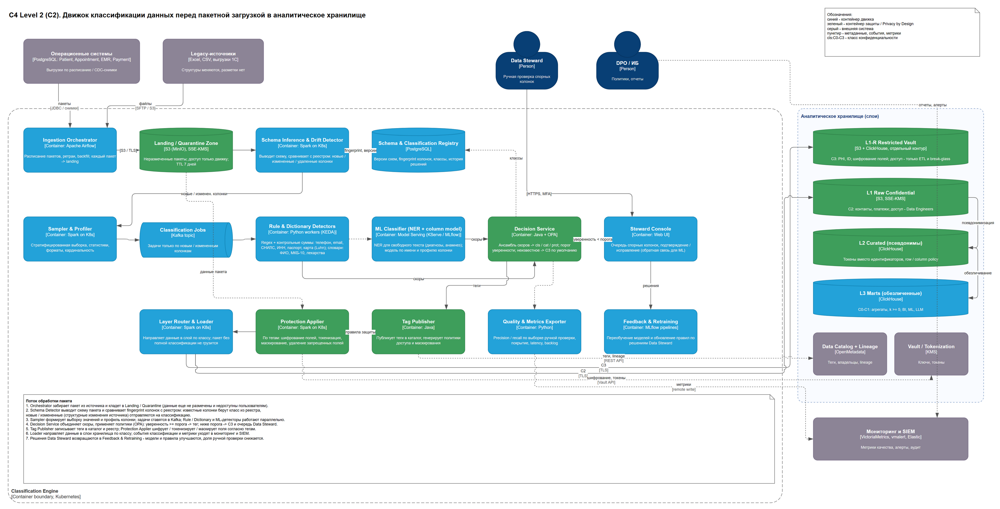

# Задание 6. Классификация данных

## Состав

| Файл | Содержание |
| --- | --- |
| [C2-classification-engine.drawio](C2-classification-engine.drawio) | Диаграмма C2 движка классификации (draw.io) |
| [C2-classification-engine.png](C2-classification-engine.png) | Экспорт диаграммы |
| README.md | Описание решения, слои хранилища, метрики, масштабирование |

## 1. Движок классификации перед пакетной загрузкой

### 1.1. Исходные условия

- Данные загружаются в хранилище пакетами (batch) из операционных БД (Patient, Appointment, EMR,
  Payment), выгрузок 1С и legacy-файлов Excel / CSV.
- Структуры на входе меняются (новые колонки, переименования, смена типов) и **не размечены** по
  классам конфиденциальности.
- Ошибка "пропустить конфиденциальное поле" (false negative) значительно дороже, чем "лишний
  раз защитить обычное поле" (false positive). Поэтому действует правило **fail-closed**:
  неизвестное = C3 Restricted до подтверждения.

### 1.2. Контейнеры

| Контейнер | Технология | Ответственность |
| --- | --- | --- |
| Ingestion Orchestrator | Apache Airflow | Расписание пакетов, ретраи, backfill, запуск конвейера для каждого пакета |
| Landing / Quarantine Zone | MinIO (S3), SSE-KMS | Временное хранение неразмеченных пакетов; доступ только сервисным учетным записям движка; TTL 7 дней |
| Schema Inference & Drift Detector | Spark on Kubernetes | Определение схемы пакета, fingerprint колонок (имя + тип + статистический профиль), сравнение с реестром, выявление структурных изменений |
| Schema & Classification Registry | PostgreSQL | Версии схем источников, известные колонки и их классы, история решений и уверенности |
| Sampler & Profiler | Spark | Стратифицированная выборка значений, профиль колонки (длина, алфавит, маски, кардинальность, доля null) |
| Classification Jobs | Kafka | Очередь задач классификации - только новые и измененные колонки |
| Rule & Dictionary Detectors | Python workers, KEDA | Регулярные выражения с проверкой контрольных сумм (СНИЛС, ИНН, номер карты по Luhn), телефоны, email, паспорт, полис; словари ФИО, МКБ-10, лекарств; эвристики по названию колонки |
| ML Classifier | KServe / MLflow | NER-модель для свободного текста (анамнез, заключения, комментарии), классификатор колонок по имени и профилю |
| Decision Service | Java + OPA | Объединение скоров (ансамбль), применение политик: класс `cls`, категория `cat`, способы защиты `prot`; уверенность ниже порога -> C3 и ручная проверка |
| Steward Console | Web UI | Очередь спорных колонок для Data Steward, подтверждение / исправление |
| Feedback & Retraining | MLflow pipelines | Решения Data Steward -> размеченный датасет -> переобучение моделей, обновление правил и словарей |
| Tag Publisher | Java | Запись тегов в реестр и Data Catalog (OpenMetadata), генерация политик доступа и маскирования для хранилища |
| Protection Applier | Spark | Применение защиты по тегам: шифрование полей (Vault), токенизация, маскирование, удаление запрещенных полей (например, номера карт) |
| Layer Router & Loader | Spark | Запись данных в слой хранилища по классу; пакет с неразрешенными колонками не загружается (кроме карантина) |
| Quality & Metrics Exporter | Python | Метрики качества классификации и работы конвейера в VictoriaMetrics, события в SIEM |

### 1.3. Поток обработки пакета

1. Orchestrator забирает пакет из источника и кладет его в Landing / Quarantine.
2. Schema Detector строит схему и сравнивает fingerprint колонок с реестром:
   - колонка известна и профиль не изменился -> класс берется из реестра (без повторной классификации);
   - новая колонка, переименование, смена типа или заметное изменение профиля (drift) -> задача на классификацию.
3. Sampler делает выборку значений; детекторы (правила, словари, ML) работают параллельно.
4. Decision Service объединяет результаты (максимальный класс среди детекторов, взвешенная
   уверенность). Уверенность выше порога -> тег назначается автоматически; ниже -> колонка
   получает C3 (fail-closed) и попадает в очередь Data Steward.
5. Tag Publisher обновляет реестр и каталог; Protection Applier защищает поля; Loader загружает
   данные в нужные слои.
6. Метрики и события классификации отправляются в мониторинг; решения Data Steward
   переобучают модели.

Отдельно обрабатываются составные поля: свободный текст (комментарии, заключения) классифицируется
по содержимому (NER), а не по имени колонки, - так находится ФИО пациента в "комментарии
к списанию" (DFD-07).

## 2. Слои хранилища для конфиденциальных данных и другие меры

### 2.1. Слои

| Слой | Хранилище | Что содержит | Защита | Кто имеет доступ |
| --- | --- | --- | --- | --- |
| L0 Quarantine | S3 (Landing) | Неразмеченные пакеты | SSE-KMS, TTL 7 дней, нет пользовательского доступа | Только движок |
| L1-R Restricted Vault | Отдельный контур: S3 + ClickHouse | Данные C3 (PHI, ID) в исходном виде; таблица соответствия токенов | Шифрование полей ключами домена, отдельная сеть, break-glass, аудит каждого запроса | ETL, DPO по заявке |
| L1 Raw Confidential | S3, SSE-KMS | Данные C2 (контакты, платежи) | Шифрование, ограниченный срок хранения | Data Engineers |
| L2 Curated | ClickHouse | Очищенные данные; прямые идентификаторы заменены токенами (HMAC), C3 - только токены / коды | Row / column policies по тегам, динамическое маскирование, аудит | Аналитики по заявке с целью `purpose:analytics` |
| L3 Marts | ClickHouse | Обезличенные агрегаты (k-anonymity, k >= 5), признаки для ML | Контроль малых групп, публикация отчетов по правилам | BI, ML, LLM, руководство |

### 2.2. Дополнительные меры (кроме слоев)

1. **Fail-closed по умолчанию** - неклассифицированное поле считается C3 и не попадает в L2 / L3.
2. **Column-level security** - политики ClickHouse генерируются из тегов автоматически, а не вручную.
3. **Токенизация и crypto-shredding** - удаление по запросу пациента: уничтожение ключа / записи
   соответствия делает данные в L2 необратимо обезличенными.
4. **Retention по тегам** - L0 7 дней, L1 ограниченный срок, далее только L2 / L3.
5. **Lineage** - каждое поле L3 прослеживается до источника; при отзыве согласия находятся все
   производные наборы.
6. **Аудит и UEBA** - все запросы к L1-R и L2 пишутся в SIEM; алерты на массовые выборки.
7. **Запрет выгрузок** - выгрузка из L1 / L2 на ПК блокируется DLP; ML-эксперименты - только в
   изолированной песочнице на L3 или синтетических данных.
8. **Проверка релизов** - изменения схем источников и конвейеров проходят проверку тегов в CI
   (Task1, Task3).

## 3. Метрики эффективности классификации

| Метрика | Как считается | Целевое значение | Как помогает оптимизации |
| --- | --- | --- | --- |
| Recall по классу C3 (полнота) | Доля действительно чувствительных колонок, распознанных как C3, по эталонной выборке ручной проверки | >= 0,99 | Главная метрика безопасности; падение -> новые правила, словари, переобучение |
| Precision по C2 / C3 (точность) | Доля колонок, верно отнесенных к классу | >= 0,9 | Низкая точность -> лишняя защита, потеря полезных данных для аналитики, рост ручной проверки |
| F1 по категориям (PII, PHI, ID, FIN) | Гармоническое среднее precision и recall | >= 0,93 | Показывает, какие детекторы слабые |
| False negative rate для C3 | Пропущенные чувствительные поля / все чувствительные | =< 1 % | Порог для алерта ИБ, каждый случай - инцидент |
| Доля автоматической классификации | Колонки, классифицированные без Data Steward / все новые колонки | >= 85 % | Снижение ручного труда; рост доли -> можно повышать порог уверенности |
| Override rate | Доля автоматических решений, исправленных Data Steward | =< 5 % | Источник обучающих данных, индикатор деградации модели |
| Покрытие каталога | Колонки с тегом / все колонки в хранилище | 100 % | Неразмеченные данные недопустимы |
| Время классификации нового поля (time-to-tag) | От появления колонки в источнике до назначения тега | Автоматически - в рамках пакета; вручную - =< 1 рабочего дня | Показывает задержку загрузки данных из-за карантина |
| Backlog карантина | Число колонок / пакетов в ожидании ручной проверки | Тренд к нулю | Сигнал нехватки Data Steward или низкой уверенности модели |
| Drift-события | Количество структурных изменений источников за период | Мониторинг | Помогает договариваться с владельцами источников о контрактах схем |
| Производительность конвейера | Пропускная способность (ГБ/ч), время пакета, стоимость на ГБ | По SLO окна загрузки | Масштабирование и оптимизация выборок |

Как метрики помогают: precision / recall и override rate определяют, где улучшать детекторы
и пороги; доля автоматической классификации и backlog показывают нагрузку на людей; time-to-tag и
производительность - влияние классификации на свежесть данных; FN rate по C3 - прямой индикатор
риска утечки. Метрики публикуются в VictoriaMetrics, алерты - через vmalert, разбор - ежемесячно.

## 4. Масштабируемость

| Направление | Решение |
| --- | --- |
| Рост объема данных (5x и более) | Классифицируются **только новые и измененные колонки**: известные колонки берут класс из реестра по fingerprint; анализ на выборке, а не на всем объеме; Spark on Kubernetes с горизонтальным масштабированием executors |
| Рост числа источников и филиалов | Партиционирование пакетов по источнику / филиалу / дате; независимые DAG в Airflow; филиал - атрибут `branch_id`, а не отдельный конвейер |
| Пиковые нагрузки | Kafka как буфер задач; воркеры детекторов масштабируются KEDA по длине очереди; модели в KServe с автомасштабированием, при необходимости GPU-пул для NER |
| Хранилище | MinIO масштабируется добавлением узлов; ClickHouse - шардирование и репликация; L1-R - отдельный кластер, масштабируемый независимо |
| Рост числа пользователей | Политики доступа генерируются из тегов (не ручная настройка на пользователя); роли и атрибуты в Keycloak / OPA; кэширование решений OPA |
| Рост числа колонок в ручной проверке | Активное обучение (active learning): модель переобучается на решениях Data Steward, доля ручной работы снижается; приоритизация очереди по риску (C3 первыми) |
| Отказоустойчивость | Идемпотентные пакеты, повтор с точки сбоя, карантин не блокирует остальные источники |
| Новые типы данных и интеграции | Детекторы - подключаемые плагины (новое правило / словарь / модель без изменения конвейера); контракт схем источников в Schema Registry |

Порядок расширения: сначала вертикальная оптимизация (выборки, кэш fingerprint, инкрементальность),
затем горизонтальное масштабирование воркеров и Spark, затем шардирование ClickHouse и выделение
L1-R в отдельный кластер.
